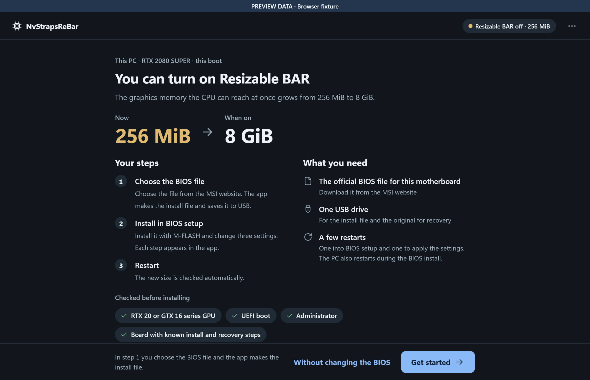
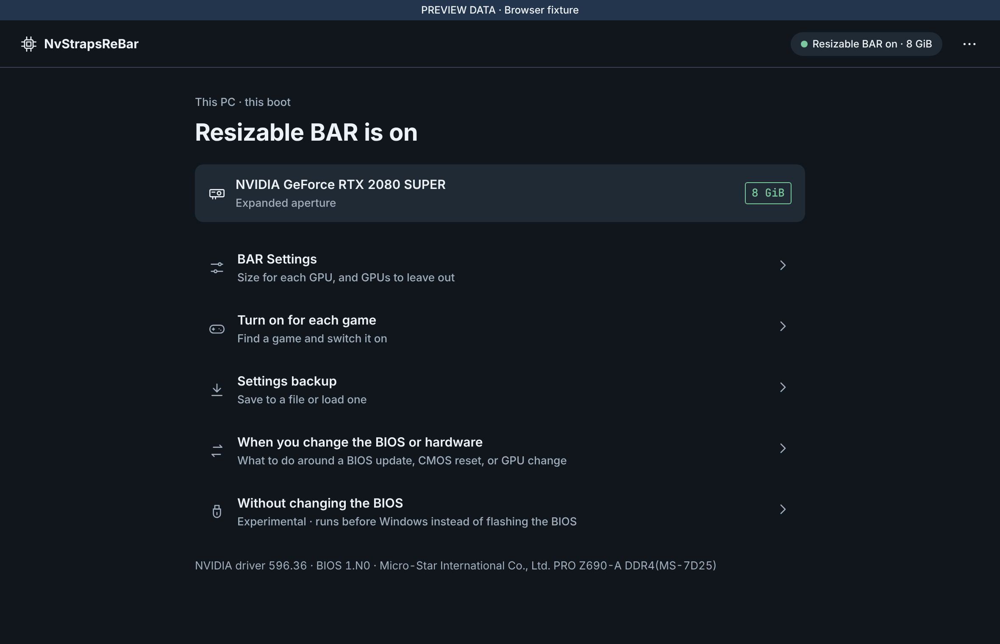

# NvStrapsReBar

**Resizable BAR for NVIDIA Turing GPUs (GTX 1600 / RTX 2000) on motherboards that never got a
ReBAR BIOS update.**

[한국어 안내 → README.ko.md](README.ko.md)

Turing GPUs support Resizable BAR in hardware, but NVIDIA never shipped it for them, and older
motherboards have no ReBAR option in BIOS setup. NvStrapsReBar closes that gap with a small UEFI
driver that runs at boot, before Windows, and widens the GPU's BAR — the memory window the CPU
uses to reach VRAM — from the default 256 MiB up to the full VRAM size. This repository is a
stable-Rust implementation of the original C/C++
[NvStrapsReBar](https://github.com/terminatorul/NvStrapsReBar), together with a Rust/Tauri app that
prepares your BIOS image and edits the driver's settings. The app is for Windows; a Linux build is
published as a preview.



*The first screen, here with the sample data of the app's preview build; the bar at the top marks
it. [More screens](docs/frontend-gallery/README.md).*

## Get the app

**Windows.** Download `NvStrapsReBar-windows-x64-setup.exe` from the
[latest release](https://github.com/115dkk/NvStrapsReBar-Tauri/releases/latest) and run it. To use
the app without installing it, download `NvStrapsReBar-windows-x64.zip` instead, extract it and
keep `NvStrapsReBar.exe` and `NvStrapsReBar.ffs` in the same folder. Either way you need Windows
x64 with WebView2, which Windows 11 and an up-to-date Windows 10 already have. `SHA256SUMS.txt` in
the release lists the checksums of both downloads.

**Linux (preview).** The Linux build is published separately, as a pre-release tagged
`linux-preview-<version>` on the
[releases page](https://github.com/115dkk/NvStrapsReBar-Tauri/releases). Download the package for
your system and install it with `sudo apt install ./nvstraps-rebar_<version>_amd64.deb` (Ubuntu
22.04 or later, Debian 12 or later) or `sudo dnf install ./nvstraps-rebar-<version>-1.x86_64.rpm`
(Fedora). On Debian and Ubuntu you can add the project's
[apt repository](https://115dkk.github.io/NvStrapsReBar-Tauri/) instead, and `apt` then offers
each new preview with the system's other updates. The Linux build does what the Windows app does
except the per-game switches and the route that leaves the BIOS alone.
[docs/LINUX.md](docs/LINUX.md) says how it works, what has been proven, and how to check the
signature of the `.rpm`.

## How the app guides you

The app opens on the state of your PC and shows one task per screen. An installation runs in four
stages, and you can close the app at any point; it reopens on the same step.

1. **Prepare** — choose the official BIOS file for your exact motherboard and confirm the install
   and recovery methods (the app fills them in for boards it knows; other boards answer three
   questions from the manual, and older Above 4G boards also review the BIOS patches the analyzer
   recommends). The app adds the NvStrapsReBar DXE driver, checks the result, and saves a package
   to your USB drive: the new BIOS file, the untouched original, checksums, and step-by-step
   instructions in English and Korean. On a board whose flashback recovery file name the app knows
   (`MSI.ROM` on the MSI PRO Z690-A DDR4), it also saves a copy of the original under that name next
   to the package.
2. **Install** — restart into BIOS setup from the app, install the new file with your vendor's own
   tool (M-FLASH, a flashback button, whatever your board uses) and change the listed settings.
   Back in Windows, the app sees NvStrapsReBar running and you record what you did.
3. **Turn on** — save the recommended sizes (the button is the confirmation; the app reads the
   value back) and restart.
4. **Finish** — the app reads the BAR size the NVIDIA driver reports. Turning Resizable BAR on per
   game is offered afterwards from the finish screen and from home.

After installation, home shows every NVIDIA GPU with its current BAR size. **BAR Settings** turns
expansion on or off, sets per-GPU sizes or exclusions, and sets a motherboard-side BAR limit for
boards that need one; saving there asks for one confirmation and takes effect at the next restart.
If you already installed the original NvStrapsReBar with other tools, the app recognizes the
expanded aperture and edits the same UEFI variable.



## What you need

- An NVIDIA Turing GPU: GTX 1600 or RTX 2000 series.
- A motherboard booting in UEFI mode, with **Above 4G Decoding** enabled and **CSM** disabled in
  BIOS setup.
- The official BIOS image for your exact board and revision, plus a flash route and a recovery
  route that actually work (flashback button, dual BIOS, or an SPI programmer).
- Windows with an administrator account — reading and writing the UEFI variable needs it. The app
  offers to restart itself as administrator when required. On Linux, the system's password dialog
  asks for an administrator's password when the app saves settings.

GTX 1000 (Pascal) and older cards are not supported: their Windows driver crashes when the BAR
changes, so the app does not offer them.

## Current status

The driver has been flashed and run on a physical board. On an MSI MAG B660 TOMAHAWK WIFI DDR5
(MS-7D41, BIOS 7D41vAO) with an RTX 2060 12GB, the image prepared with this project's injector went
in through MSI's own M-FLASH, the app configured the driver, and both the app and GPU-Z then
reported a 16 GiB BAR1 ([hardware report](https://github.com/115dkk/NvStrapsReBar-Tauri/issues/39)).
The per-game switches have been verified against the NVIDIA driver on the maintainer's PC (RTX
2080 SUPER, driver 616.64). Sleep and resume with the expanded BAR has not been reported from a
physical board yet.

On Linux, one user has reported a complete run of the 1.1.5 preview on a physical PC (Ubuntu 26.10,
MSI Z390-A PRO, RTX 2080 Ti), from making the BIOS file in the app to Resizable BAR at 16 GiB
([report](https://github.com/115dkk/NvStrapsReBar-Tauri/issues/63#issuecomment-6783051817)). The
maintainers have not run the Linux build on a physical PC themselves.

Every other board is still your own trial. A bad BIOS flash can leave a board unbootable; continue
only after confirming your recovery route works. For the MSI PRO Z690-A DDR4 (MS-7D25) the app
prefills the documented M-FLASH install and Flash BIOS Button recovery routes; on other boards you
choose the routes yourself.

Some boards refuse a changed BIOS file because the maker's signature covers the part the driver
goes into ([issue #54](https://github.com/115dkk/NvStrapsReBar-Tauri/issues/54)); the app warns
before it makes such a file. For those boards it also has an experimental route that leaves the BIOS
alone: a small EFI program runs before Windows from a USB drive, or from the EFI system partition
with its own boot entry, and moves the GPU's BAR1. Release builds are signed, so Secure Boot can stay
on once you add the project's certificate in BIOS setup (the app shows how). It cannot move a GPU that
shows the boot picture, and has only run on QEMU so far ([details](docs/EXTERNAL_EFI.md)).

The app runs on Windows x64, and on Linux x86-64 as a preview ([docs/LINUX.md](docs/LINUX.md)). The
per-game switches are on Windows only, because they go through NVIDIA's Windows driver API. macOS
has no NVIDIA driver for Turing GPUs at all. The UEFI driver itself does not care which operating
system boots afterwards.

## Checking the result

Run `nvidia-smi -q -d memory`, or just look at the app's home screen: an expanded GPU shows its
new BAR size in green. The NVIDIA driver applies Resizable BAR per application. **Turn on for each
game** lists the driver's game profiles: search for a game and flip its switch, or turn on
**All games** for every game without its own setting. Each profile's earlier values are recorded
the first time the app changes it, and the same screen puts them back without touching other
NVIDIA settings, even after a driver update. Changes apply the next time a game starts and
need the app to run as administrator. The setting IDs come from
[NVIDIA Profile Inspector](https://github.com/Orbmu2k/nvidiaProfileInspector); the app talks to
the driver through NVIDIA's public NVAPI.

## Before changing hardware

Save your settings to a file first (BAR Settings has a button for it), turn the expansion off,
save, shut down, and only then swap GPUs or move cards between slots. After the change, load the
file to restore your settings. The driver finds the GPU by addresses the firmware assigns at boot, and those
addresses move when the hardware changes. Two escape hatches work without Windows: when BIOS
setup settings change, the driver sits out that boot (this guard is on by default), and after a
CMOS reset — clock battery pulled or jumper cleared — it saves itself in the off state.

## Development

Requirements: Node.js 24+, stable Rust with `rustfmt` and `clippy`, and the `x86_64-unknown-uefi`
target. Users of a packaged build need none of these.

```powershell
npm ci
npm run check        # TypeScript, unit tests, lint
npm run check:rust   # fmt, clippy, host and UEFI-target tests
npm run tauri dev
```

Release builds and the remaining gates:

```powershell
npm run tauri:ci     # NvStrapsReBar.exe + NvStrapsReBar.ffs (embedded into the app)
npm run test:e2e     # Playwright journeys
npm run check:firmware
npm run check:riir   # rejects tracked C/C++ and the removed EDK2 build trees
npm run check:miri   # needs: rustup toolchain install nightly --component miri --profile minimal
```

`npm run check:miri` interprets the host-safe contracts and the volatile BAR1 MMIO code. Windows
FFI and UEFI protocol boundaries stay covered by compilation, Clippy, native tests, and — on
Linux with QEMU and OVMF installed — `npm run test:qemu`, which boots an injected OVMF copy with
an isolated variable store, configures the driver, and puts the virtual machine through an ACPI S3
suspend and resume.

The installer wraps the same two files with Inno Setup 7. After `npm run tauri:ci`, run
`ISCC.exe installer\NvStrapsReBar.iss`; it writes `target\installer\NvStrapsReBar-windows-x64-setup.exe`,
which shows the MIT license, adds a Start menu shortcut and offers a desktop shortcut. CI publishes
it next to the portable ZIP.

Releases are automatic. The checks (the Linux and Windows builds and tests, the Rust UEFI validation
and Miri) run on pull requests, not again on `master`. Every merge into `master` that changes what
ships (the app, the UEFI driver and its crates, bundled assets, dependencies, the installer) becomes
a stable release when its pull request passed those checks on exactly the tree that was merged;
merges that only touch documentation, CI, tests or test tooling release nothing. The workflow picks the level from the
change itself: a change to the UEFI driver or its shared contract is a minor release, because users
must re-flash to get it, and any other program change is a patch. A commit subject can raise it with
a `feat:` / `minor:` prefix (minor) or `major:` / `breaking:` / `feat!:` (major). The Windows job
writes the new version into every manifest, builds with it, commits that bump to `master` as
`github-actions[bot]`, and publishes the tag as the **Latest** release with the build attached,
using `docs/releases/v<version>.md` as notes when that file exists and generated notes otherwise.
Nothing goes through the Actions artifact store.

Deeper documentation:

- [Rust UEFI implementation status](docs/RUST_UEFI_PORT.md)
- [Tauri backend contract](docs/TAURI_BACKEND.md)
- [Linux support (in progress)](docs/LINUX.md)
- [RIIR and one-click deployment boundaries](docs/RIIR_AND_ONE_CLICK.md)
- [Domain language](CONTEXT.md)
- [Screens of the app, in English and Korean](docs/frontend-gallery/README.md)

## Credits

This work builds on the original C/C++
[NvStrapsReBar](https://github.com/terminatorul/NvStrapsReBar) by @terminatorul, the
[ReBarUEFI](https://github.com/xCuri0/ReBarUEFI) project it grew from, and findings from
[envytools](https://github.com/envytools/envytools), @mupuf, and @Xelafic. The pinned legacy
patch catalogs retain their upstream provenance and hashes.

Special thanks to @lucianocerantonio2, who flashed the first physical board with this project's
image, configured it, and reported the 16 GiB result with hashes and screenshots
([issue #39](https://github.com/115dkk/NvStrapsReBar-Tauri/issues/39)).

Thanks also to @FasteryXD, who ran the Linux preview on a physical PC from start to finish and
wrote down what happened at every step. Versions 1.1.6 and 1.1.7 changed what that report pointed
at ([issue #63](https://github.com/115dkk/NvStrapsReBar-Tauri/issues/63)).

## Licenses

Repository-owned source code is distributed under the [MIT license](LICENSE). The bundled
Pretendard Variable and Jetendard fonts remain under the SIL Open Font License 1.1; they are not
relicensed under MIT. See [third-party notices](THIRD_PARTY_NOTICES.md) for their pinned
provenance and hashes, or use the application's **Licenses** button to read the copyright notices
and full OFL texts offline.
