# Frontend gallery

The current English and Korean interface of the NvStrapsReBar app, in the order a user meets it:
home, the four install steps, and the pages used after installation.

> [!NOTE]
> These captures come from the production build running the repository's browser-preview
> fixtures, so every screen carries the "PREVIEW DATA" bar. They do not show native WebView2
> behaviour, native dialogs, firmware reads or writes, flashing, restarts, or results from NVIDIA
> hardware. They were taken in headless Chromium on Linux: Korean text uses the bundled Pretendard
> exactly as on Windows, while English text falls back to Pretendard where Windows shows Segoe UI.

The 900 px captures show the smallest supported desktop window. Every image is captured at device
scale 2.

To capture the gallery again after the interface changes:

```sh
npm run build
node scripts/capture-frontend-gallery.mjs
```

The script replaces every PNG in this folder. Pass name prefixes such as `11` to capture only those
images, and set `NVSTRAPS_GALLERY_CHROMIUM` to a Chromium binary when the browser bundled with
`@playwright/test` is not installed.

## Home

### 1. Resizable BAR is on · English, 1180 × 760

After NvStrapsReBar has expanded the GPU, home shows its BAR size and links to the rest of the app:
BAR Settings, the per-game switches, a settings backup, steps for a BIOS or hardware change, and the
experimental route that leaves the BIOS alone.

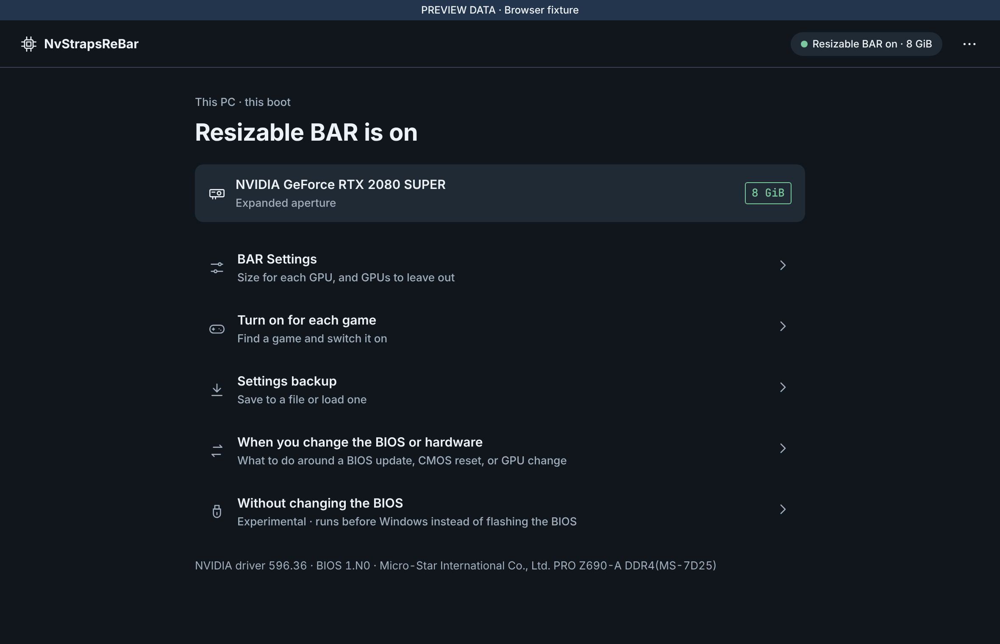

### 2. 처음 여는 화면 · 한국어, 1180 × 760

드라이버가 아직 실행된 적 없는 PC에서 앱을 열면 나오는 화면입니다. 지금 BAR 크기와 켰을 때의 크기, 사용자가
할 일 세 가지, 준비물, 설치 전에 확인한 항목이 나옵니다. 'BIOS 수정 없이'를 누르면 BIOS를 고치지 않는 실험용
방식으로 넘어갑니다.

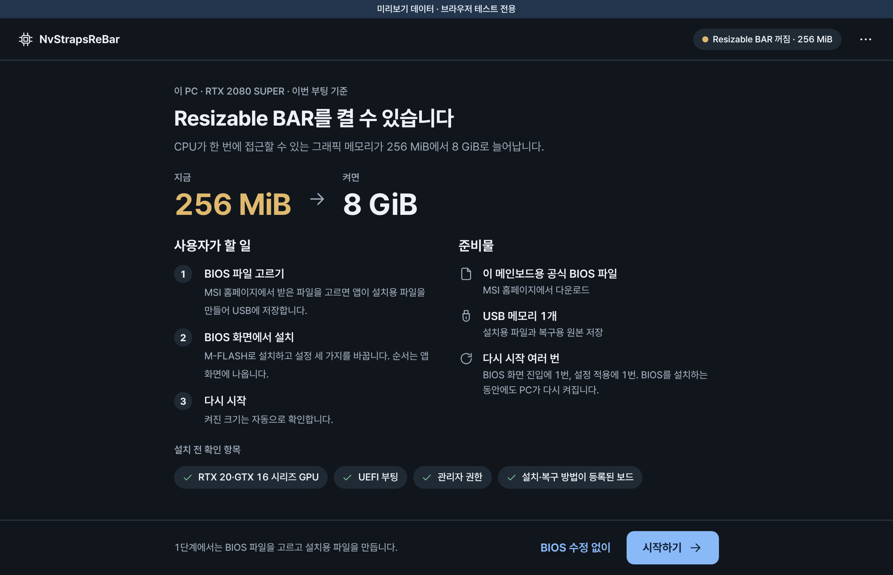

## Install

### 3. Choose the motherboard BIOS file · English, 1180 × 760

Step 1 of four. The screen shows the detected board and which file in the vendor download to choose.

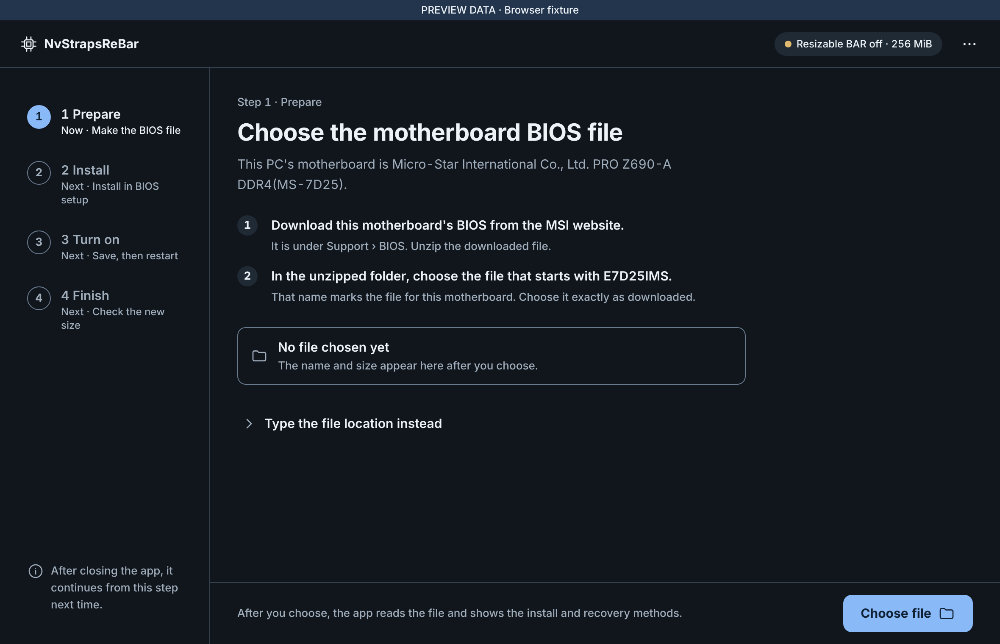

### 4. 설치와 복구 방법 확인 · 한국어, 900 × 760

앱에 등록된 보드(MSI PRO Z690-A DDR4)에서는 설치 방법(M-FLASH)과 복구 방법(Flash BIOS Button)이 미리 골라져
있습니다. 고른 파일의 이름과 크기, 두 방법을 확인할 MSI 안내서 주소도 함께 나옵니다.

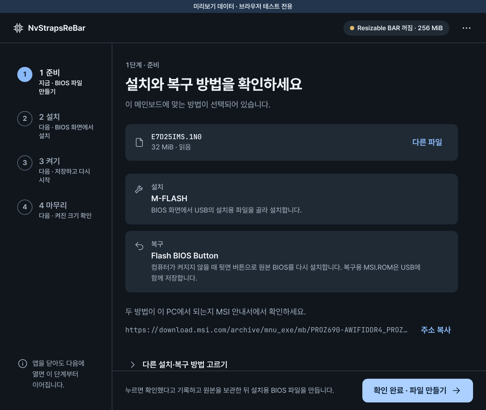

### 5. Save to USB · English, 900 × 760

The install BIOS file passed the check. The screen lists what goes to the USB drive: the install
file under its original name, MSI.ROM for Flash BIOS Button recovery, and the instructions in
English and Korean.

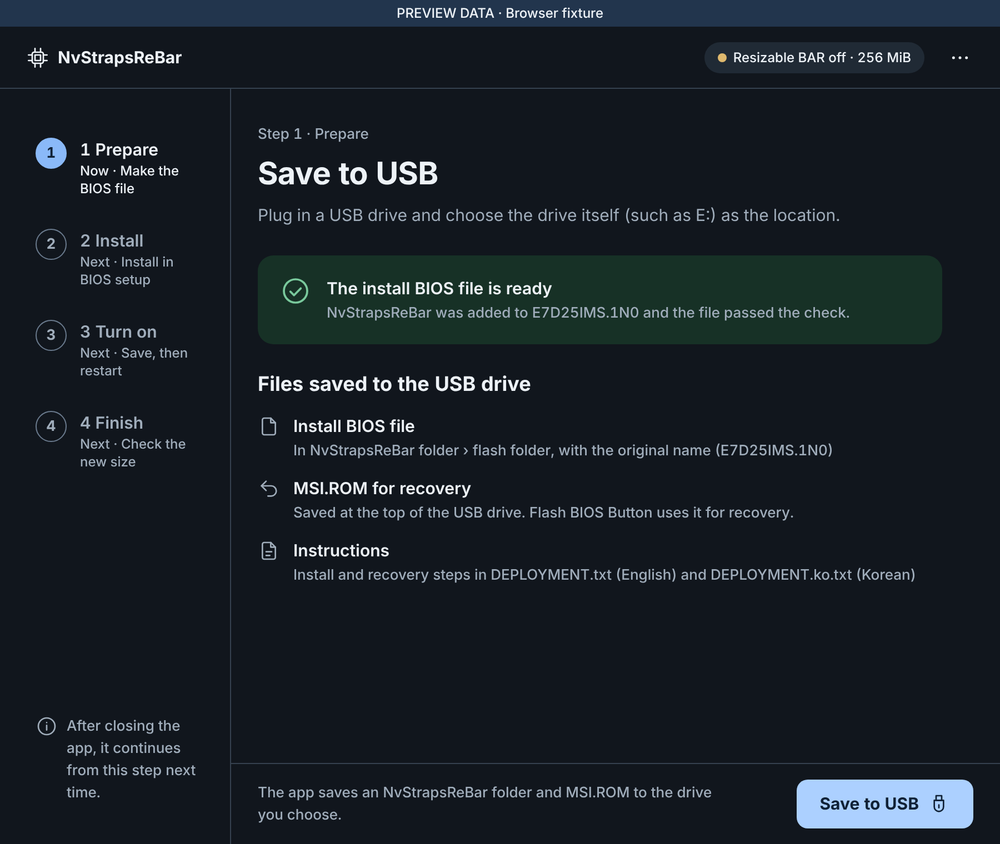

### 6. BIOS 화면에서 설치 · 한국어, 1180 × 760

2단계입니다. M-FLASH로 설치하는 순서, 바꿔야 할 BIOS 설정 세 가지(Above 4G Decoding 켜기, CSM 끄기,
Re-Size BAR 켜기), 설치가 잘못됐을 때 복구하는 방법이 나옵니다. BIOS 화면으로 다시 시작하기 전에 확인 창이
한 번 더 뜹니다.

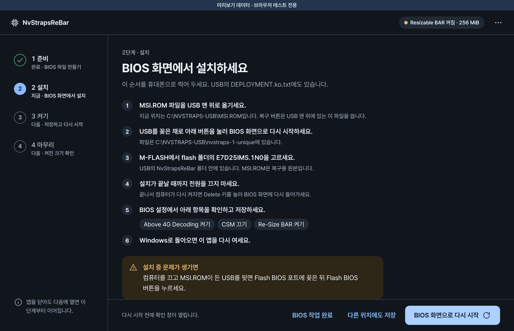

### 7. Record what you did in BIOS setup · English, 900 × 760

Back in Windows, the screen shows that NvStrapsReBar ran during this boot. The user then records
the two things only they can confirm: the M-FLASH install and the BIOS settings.

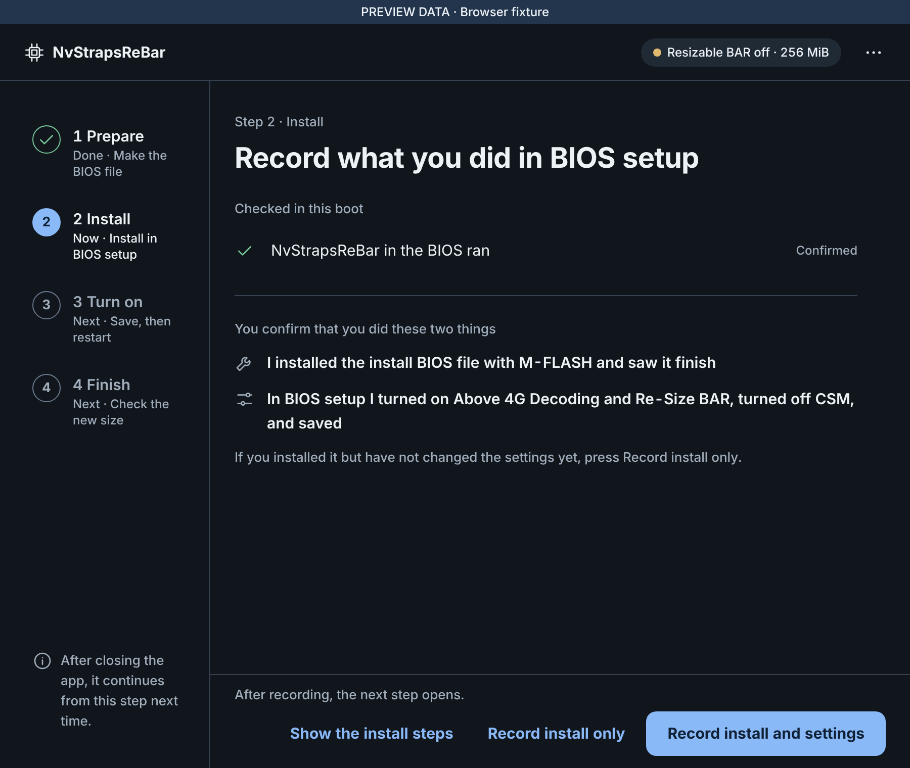

### 8. 켤 준비 · 한국어, 1180 × 760

3단계입니다. GPU마다 지금 크기와 켰을 때의 크기가 나옵니다. '이 설정으로 저장'을 누르면 설정을 저장하고 다시
읽어 저장됐는지 확인하며, 설정은 다시 시작한 뒤에 적용됩니다.

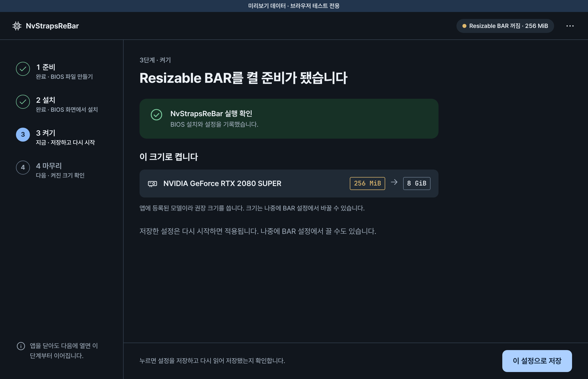

## After installation

### 9. Only some GPUs are expanded · English, 900 × 760

With two GPUs, home shows which one is still at 256 MiB and links to BAR Settings.

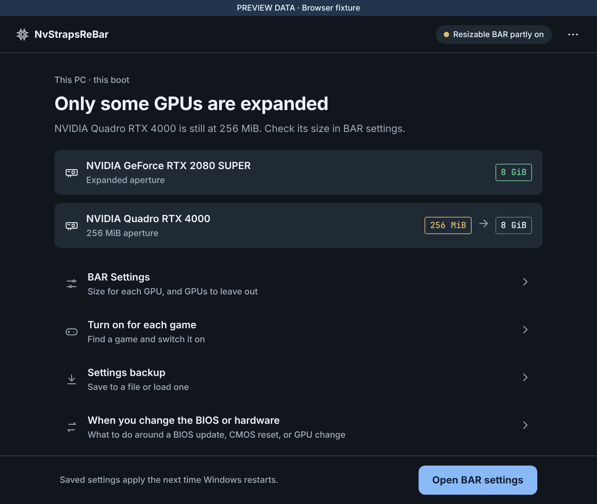

### 10. BAR Settings · English, 1180 × 760

The expansion switch, the size each GPU gets after the next restart, and the advanced options
opened: which GPUs to expand and the motherboard-side BAR size.

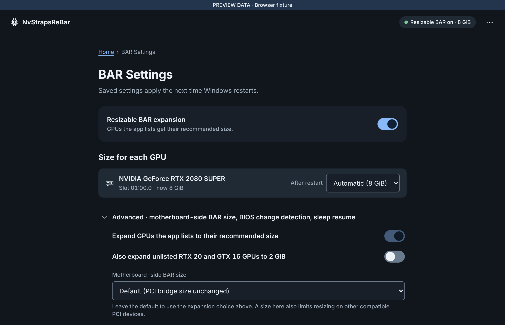

### 11. Turn on for each game · English, 1180 × 760

The NVIDIA driver decides per game whether to use Resizable BAR. Elden Ring was switched on, so it
is listed under "Games changed on this PC"; the All games switch covers every game without its own
setting.

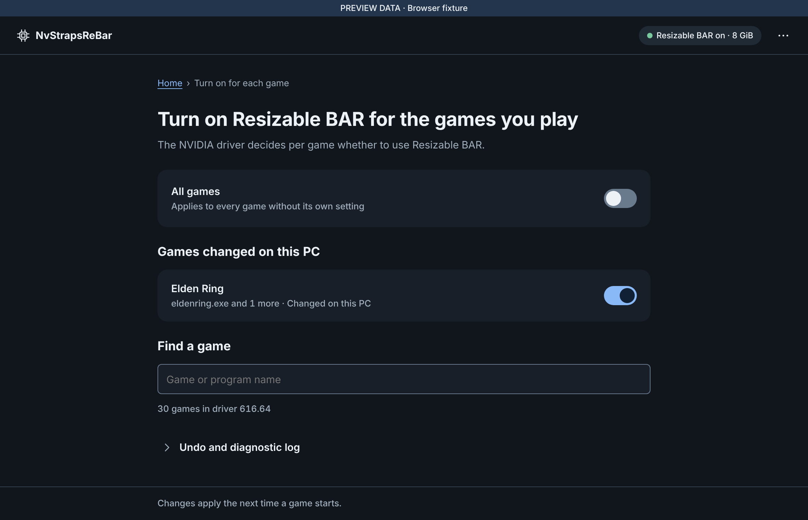

### 12. BIOS를 고치지 않는 방식 · 한국어, 1180 × 760

실험용 방식입니다. PC를 켤 때 작은 EFI 프로그램을 Windows보다 먼저 실행해 GPU의 BAR 크기를 늘리고, BIOS
파일은 그대로 둡니다. USB에서 시험해 보거나 이 PC의 EFI 시스템 파티션에 설치할 수 있습니다.

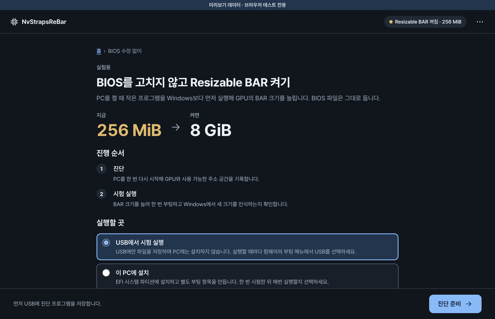

## Earlier captures

Captures of earlier interfaces were removed when this gallery was replaced. They remain in the
repository history: [the gallery as of v1.1.2](https://github.com/115dkk/NvStrapsReBar-Tauri/tree/v1.1.2/docs/frontend-gallery).

---

Captured from v1.1.2 in headless Chromium 153.0.8010.12 on Linux, at device scale 2 with reduced
motion.
